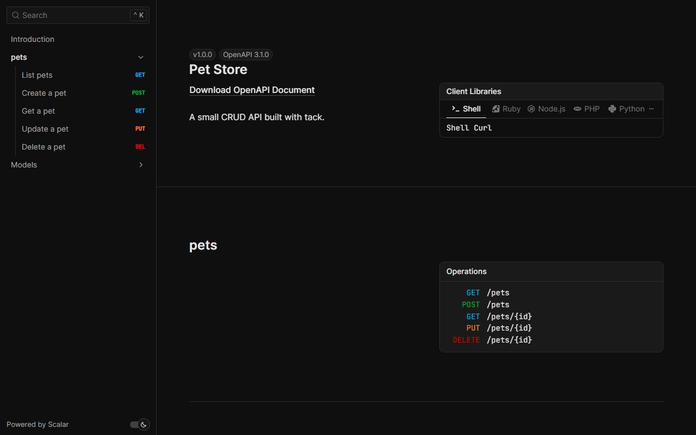
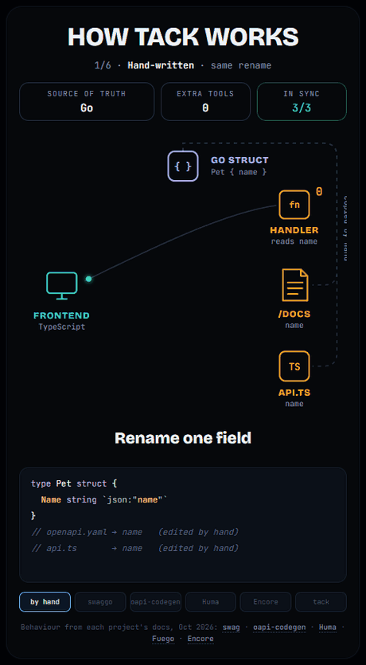

# tack

**Type-safe HTTP APIs for Go with docs that never drift from your code. Declare a struct once — get validation, OpenAPI docs, and a TypeScript client for free.**

[](https://pkg.go.dev/github.com/raven-clown/tack)
[](https://github.com/raven-clown/tack/actions/workflows/ci.yml)
[](https://github.com/raven-clown/tack/actions/workflows/security.yml)
[](https://github.com/raven-clown/tack/actions/workflows/codeql.yml)
[](https://scorecard.dev/viewer/?uri=github.com/raven-clown/tack)
[](LICENSE)

> **Early development.** tack is pre-1.0. The API may change between minor versions until v1.0. See the [roadmap](#roadmap).

---

## Why tack?

Writing an API in Go usually means doing the same work three times:

1. Parse and validate the request by hand.
2. Write the OpenAPI spec (or comments that generate it) separately — and watch it drift out of date.
3. Write TypeScript types for the frontend — again by hand.

tack makes **your Go types the single source of truth**. You write a handler that takes a struct and returns a struct. tack does the rest.

```go
package main

import (
	"context"
	"net/http"

	"github.com/raven-clown/tack"
)

type GetPetInput struct {
	ID int `path:"id" validate:"min=1" doc:"Pet ID"`
}

type Pet struct {
	ID   int    `json:"id"`
	Name string `json:"name" validate:"required,max=50"`
}

func main() {
	app := tack.New(tack.Config{Title: "Pet API", Version: "1.0.0"})

	tack.Get(app, "/pets/{id}", func(ctx context.Context, in GetPetInput) (Pet, error) {
		if in.ID == 404 {
			return Pet{}, tack.NewError(http.StatusNotFound, "pet not found")
		}
		return Pet{ID: in.ID, Name: "Milo"}, nil
	})

	http.ListenAndServe(":8080", app) // open http://localhost:8080/docs
}
```

That's it. You now have:

- **Automatic binding** from path, query, header, cookie, and JSON body
- **Validation** with clear, field-level error messages
- **Standard errors** in [RFC 9457](https://www.rfc-editor.org/rfc/rfc9457) `application/problem+json` format
- **OpenAPI 3.1** at `/openapi.json` — always in sync with your code
- **Interactive docs** at `/docs`, including the auth schemes you declare
- **Typed errors** declared per route and listed in the docs by code
- **TypeScript client** generated from the same types, where the errors a route declares form a typed union
- **Zod schemas** with the same validation rules, for forms that check before they send
- **`tack dev`** to rebuild the app and the client on every save, and **`tack mock`** to serve example responses before the API exists

## Installation

```bash
go get github.com/raven-clown/tack
```

Requires one of the two most recent Go releases.

## Features

### Docs that never drift

`/docs` and `/openapi.json` are generated from the same structs that bind and validate requests, so they can't fall out of date. Describe routes with options and fields with tags:

```go
tack.Get(app, "/pets", listPets, tack.Summary("List pets"), tack.Tags("pets"))

type ListPetsInput struct {
	Limit int `query:"limit" default:"20" validate:"min=1,max=100" doc:"Maximum number of pets"`
}
```



Change the paths with `Config.SpecPath` and `Config.DocsPath`, or set either to `"-"` to turn it off.

### Validation errors that make sense

Send a bad request and get every problem at once — not just the first one:

```json
{
  "type": "about:blank",
  "title": "Unprocessable Entity",
  "status": 422,
  "detail": "validation failed",
  "errors": [
    { "location": "body.name", "message": "is required" },
    { "location": "path.id", "message": "must be at least 1" }
  ]
}
```

### Errors your clients can switch on

Define an error once, return it from handlers, and declare it on the routes that can produce it. It shows up in `/docs` under its status with a stable `code`, which the TypeScript client turns into a typed union:

```go
var ErrPetNotFound = tack.DefineError(http.StatusNotFound, "pet_not_found", "pet not found")

tack.Get(app, "/pets/{id}", func(ctx context.Context, in GetPetInput) (Pet, error) {
	return Pet{}, ErrPetNotFound.WithDetail(fmt.Sprintf("pet %d not found", in.ID))
}, tack.Errors(ErrPetNotFound))
```

```json
{ "type": "about:blank", "title": "Not Found", "status": 404, "code": "pet_not_found", "detail": "pet 7 not found" }
```

Every route also documents `validation_failed` (422) and `internal` (500). Replace the whole error format with `Config.ErrorHandler`.

### A TypeScript client that cannot go stale

`tsgen` turns the OpenAPI document into one dependency-free TypeScript file built on `fetch`. Each route is a method whose result is either the typed data or one of the problems the route declares, so the frontend switches on `code` and the compiler knows which codes exist:

```ts
import { Client } from "./api";

const api = new Client({ baseUrl: "https://api.example.com", credentials: { bearer: () => token } });

const res = await api.getPetsById({ id: 7 });
if (!res.ok) {
  switch (res.error.code) {
    case "pet_not_found":      // only the codes this route declares compile here
      return showNotFound(res.error.detail);
    case "validation_failed":
      return showErrors(res.error.errors);
  }
}
res.data.name;                 // Pet
```

Generate the client where the routes are, and let the same test fail CI when the committed file is older than the code:

```go
func TestClient(t *testing.T) {
	if err := tsgen.Check(newApp().OpenAPI(), "client/api.ts"); err != nil {
		t.Fatal(err) // regenerate with tsgen.Generate, or go test . -update
	}
}
```

The `tack` command does the same from a running server or an exported document:

```bash
go install github.com/raven-clown/tack/cmd/tack@latest
tack gen ts -spec http://localhost:8080/openapi.json -o client/api.ts
tack check  -spec openapi.json client/api.ts   # exit 1 when stale
```

Responses the document does not describe, such as a proxy's 502, are thrown as `ApiError`; `unwrap(res)` throws the same class for code that prefers exceptions. See [examples/petstore/client/api.ts](examples/petstore/client/api.ts) for a generated file.

### Zod schemas from the same rules

`tack gen zod` (or `tsgen.GenerateZod`) writes one [Zod](https://zod.dev) schema per type and per route input, carrying the `validate` rules the server enforces, so a form can reject bad input before the request and show the same errors the API would:

```ts
import { PostPetsInput } from "./schemas";

const result = PostPetsInput.safeParse({ body: form });   // name: max 50, kind: cat | dog | bird
```

The file imports `zod` and works with Zod 3.23 and later, Zod 4 included. `tsgen.CheckZod` and `tack check -zod` keep it fresh the same way as the client. See [examples/petstore/client/schemas.ts](examples/petstore/client/schemas.ts).

### Save a Go file, get a fresh client

`tack dev` builds the app, runs it, and regenerates the client from the running app's document. Save any Go file and it does it all again; a build error keeps the current app running and waits for the next save:

```bash
tack dev -o client/api.ts -zod client/schemas.ts     # builds and runs the current directory
tack dev -spec http://localhost:3000/openapi.json -- go run ./cmd/server
```

The stale window between a Go change and a correct client is the length of one build, and the frontend's type checker sees the change in the editor.

### A mock before the API exists

`tack mock` serves every operation in a document with example responses built from the schemas, including the declared errors on request, so a frontend can be built against the contract first:

```bash
tack mock -spec openapi.json                      # http://127.0.0.1:8081
curl -H "Prefer: code=404" localhost:8081/pets/7  # {"code":"pet_not_found", ...}
```

### Groups and middleware

Groups share a path prefix, middleware, and options. Middleware is plain `func(http.Handler) http.Handler` at the app, group, and route level, so anything written for `net/http` or chi works as is:

```go
app.Use(middleware.RequestID, middleware.Logger)

v1 := app.Group("/v1")
admin := v1.Group("/admin", requireAdmin).With(tack.Security("bearer"))
tack.Get(admin, "/users", listUsers, tack.Middleware(audit))
```

Middleware stores values in the request context; handlers read them back typed with `tack.ContextValue[User](ctx, userKey{})`.

### Auth schemes in the docs

Declare the schemes in `Config.Security` and bind them with `tack.Security`. `/docs` gets a token field and sends the credentials; your middleware checks them and answers with `app.WriteError(w, r, tack.ErrUnauthorized)`. See [examples/auth](examples/auth) for a JWT login.

```go
app := tack.New(tack.Config{Security: map[string]openapi.SecurityScheme{"bearer": tack.Bearer("JWT")}})
```

### Response headers and status

An output struct with a `Body` field can set response headers, which are documented in the spec, and override the status set with `tack.Status`:

```go
type CreatePetOutput struct {
	Status   int
	Location string `header:"Location"`
	Body     Pet
}
```

### Just `net/http`

A `*tack.App` is an `http.Handler`. Use it with `http.Server`, mount it inside another router, and use any standard middleware (`func(http.Handler) http.Handler`). No lock-in.

### Fast by design

All reflection happens **once**, when routes are registered. At request time tack only runs a precomputed binding plan. See [BENCHMARKS.md](BENCHMARKS.md).

### Mistakes caught at startup

Declare a route with `{id}` in the path but no matching `path:"id"` field? tack panics at registration with a message telling you exactly what to fix — not at 3 a.m. in production.

## How it compares

<p align="center"></p>

<p align="center"><sub>The same field rename, six approaches. Source: <a href=".github/assets/how-tack-works.html">how-tack-works.html</a>.</sub></p>

| | net/http only | Gin / Echo / Fiber | **tack** |
| --- | --- | --- | --- |
| Typed handlers | No | No | Yes |
| Validation built in | No | Partial | Yes |
| OpenAPI from code | No | Via plugins / comments | Yes |
| TypeScript client | No | No | Yes |
| Standard `http.Handler` | Yes | Varies | Yes |

## Prior art and inspiration

Every piece of tack exists somewhere already. What tack adds is putting them in one place: code-first on `net/http`, validation, OpenAPI, a TypeScript client with typed errors, Zod schemas from the same rules, and a dev loop, with no special toolchain. These projects showed the way.

| Project | What tack takes from it |
| --- | --- |
| [FastAPI](https://fastapi.tiangolo.com/) (Python) | The core idea: declare a type once, get validation and docs for free |
| [tRPC](https://trpc.io/) (TypeScript) | End-to-end types that reach the frontend, and typed errors |
| [Huma](https://github.com/danielgtaylor/huma) | Code-first design in Go: struct tags for validation, OpenAPI 3.1, RFC 9457 errors |
| [Fuego](https://github.com/go-fuego/fuego) | Building on Go 1.22's `net/http` routing instead of shipping a router |
| [Encore](https://encore.dev/) | Proof that a built-in TypeScript client is what teams want; tack does it without tying you to a toolchain |
| [Goa](https://goa.design/) and [Lawrence Jones's write-up](https://blog.lawrencejones.dev/goa/) | "Let the compiler catch it": both the Go and TypeScript compilers check that the two sides agree, which that article achieved by chaining several tools back in 2022 |
| [turborpc](https://github.com/turborpc/turborpc) | A one-line API for getting a client, which became `app.WriteTypeScript()` |
| [go2type](https://github.com/dx314/go2type) | Generating TanStack Query hooks (planned for v1.6) |
| [zen](https://github.com/Hypersequent/zen) and [goldenthread](https://github.com/blackwell-systems/goldenthread) | Turning `validate` tags into Zod, and checking that both sides still agree, which is where `tack check` comes from |
| [guts](https://github.com/coder/guts) | Go types to TypeScript; a candidate base for tack's generator |
| [go-zero's goctl](https://github.com/zeromicro/go-zero) | Clients in several languages (planned for v1.7) |

If you know of a project that already covers all of this, please open an issue.

## Roadmap

As of v0.5 the parts that set tack apart are all in place; the public launch follows.

| Version | Focus | Status |
| --- | --- | --- |
| v0.1 | Core: typed handlers, binding, validation, errors | Done |
| v0.2 | OpenAPI 3.1 + `/docs` | Done |
| v0.3 | Route groups, middleware, auth schemes in `/docs`, errors declared per route | Done |
| v0.4 | TypeScript client where the declared errors form a typed union; `tack check` fails CI when the client is stale | Done |
| v0.5 | `tack dev` (save a Go file, get a fresh client), Zod schemas from `validate` tags, `tack mock` | Done |
| v0.6 | File uploads, SSE, `tack new`, graceful shutdown, CLI releases | Planned |
| v0.9 | Release candidate: API review, fuzzing, benchmarks | Planned |
| v1.0 | Stable API, docs site, real-world examples | Planned |

After v1.0, add-ons ship as separate modules:

| Version | Add-on | What it does |
| --- | --- | --- |
| v1.1 | `tackdb`, `tack new --db postgres --cache redis` | PostgreSQL errors mapped to 404/409/422 and shown in `/docs`, a transaction per request, `/health`; a project template with sqlc, migrations, and docker-compose |
| v1.2 | `tackcache`, `tack.Page[T]` | Redis response caching declared per route and shown in `/docs`; typed pagination that reaches the TypeScript client |
| v1.3 | `tacktest`, `tack diff` | A typed test client; breaking-change detection for pull requests |
| v1.4 | `tackauth`, `tackjobs` | JWT and session middleware with typed users and automatic 401/403 docs; typed background jobs on River |
| v1.5 | `tackotel`, rate limits, `tack build` | OpenTelemetry per operation; rate limits declared in `/docs`; small container images |
| v1.6 | `tackmcp`, frontend hooks | Routes exposed as MCP tools; TanStack Query hooks for React and Vue |
| v1.7 | More clients | Go, Swift, Kotlin, and Python clients with the same typed errors |
| v1.8 | Versioning, webhooks, WebSocket | API versions side by side; typed webhooks and WebSocket messages |
| v1.9 | Tooling | VS Code extension, browser playground, `tack vet` |

tack will not ship its own router, database driver, ORM, Redis client, sign-up system, HTML templating, or infrastructure tooling. Existing libraries do those well.

## Quality and security

Every push and pull request runs:

| Check | What it does |
| --- | --- |
| Unit tests | Table-driven tests, `Example` tests for every public function, and golden files for generated JSON Schema and OpenAPI; run with `-race` on the two most recent Go releases |
| Coverage | Fails below 85% total coverage; the report is in the job summary |
| Lint | golangci-lint with the config in `.golangci.yml` |
| govulncheck | Known vulnerabilities reachable from tack's code |
| gosec | Static analysis for common Go security mistakes |
| Trivy | Dependencies, leaked secrets, and misconfiguration across the repository |
| CodeQL | Semantic code analysis |
| Generated clients | openapi-generator validates the petstore spec and builds Go and TypeScript clients from it |
| OpenSSF Scorecard | Weekly supply-chain posture score, published on the badge above |

Dependabot keeps dependencies and actions current, and GitHub secret scanning with push protection is on. Findings land in the repository's Security tab. To report a vulnerability, follow [SECURITY.md](SECURITY.md).

Run the same checks locally:

```bash
go test -race -coverprofile=coverage.out ./... && go tool cover -func=coverage.out | tail -1
```

```bash
go run github.com/golangci/golangci-lint/v2/cmd/golangci-lint@latest run && go run golang.org/x/vuln/cmd/govulncheck@latest ./...
```

## Documentation

- [Architecture](ARCHITECTURE.md) — how tack works inside
- [Examples](examples/) — runnable example projects
- [API reference](https://pkg.go.dev/github.com/raven-clown/tack)

## Contributing

Contributions are welcome! Please read [CONTRIBUTING.md](CONTRIBUTING.md) and our [Code of Conduct](CODE_OF_CONDUCT.md) first. Looking for a place to start? Try an issue labeled [`good first issue`](https://github.com/raven-clown/tack/labels/good%20first%20issue).

Found a security issue? Please follow [SECURITY.md](SECURITY.md) instead of opening a public issue.

## License

[MIT](LICENSE)
